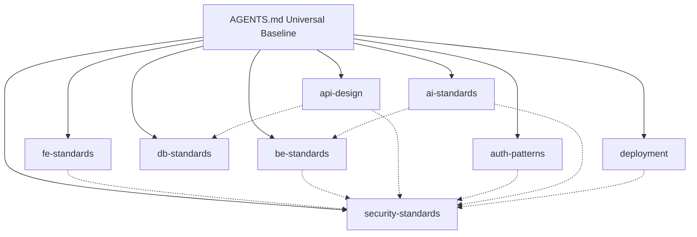

# devmind

> **The Shared Brain for AI Coding Agents**  
> *Production-grade engineering standards, security controls, and architectural patterns for Antigravity, Cursor, Windsurf, Claude Code, and GitHub Copilot.*

---

## What is devmind?

When you ask an AI coding agent to implement an authentication flow, a database migration, or a data table, you get wildly inconsistent results: speculative abstractions, unpaginated queries that blow up production databases, leaked SQL exceptions, or insecure token storage.

**devmind solves this by equipping your agents with a shared, codified engineering brain.**

Every domain in devmind is an authoritative skill that instructs the agent to:
1. **Interview you first** on architectural decisions with sensible defaults.
2. **Enforce the simplest maintainable solution (YAGNI)** before introducing any code or dependencies.
3. **Adhere to battle-tested standards** — WCAG 2.2 AA accessibility, NIST SSDF, OWASP ASVS 5.0, and RFC 7807 problem details.
4. **Run a strict verification checklist** before marking any implementation complete.

---

## Available Skills

| Skill | Domain | Standards & Baseline | Status |
|-------|--------|----------------------|--------|
| **[fe-standards](./skills/fe-standards/)** | Frontend Engineering | WCAG 2.2 AA (30 UX areas), 8-state interaction matrix, design tokens (`tokens.css`), TypeScript strict, SWR mutations, human UX copy with zero technical leaks | `Stable` |
| **[be-standards](./skills/be-standards/)** | Backend Engineering | Clean architecture, DTO allowlists, RFC 7807 typed errors, Pino structured logging, mandatory pagination & filters, Vitest/Supertest integration tests | `Stable` |
| **[security-standards](./skills/security-standards/)** | Application Security | NIST SP 800-218 v1.1 (SSDF) and OWASP ASVS 5.0, Argon2id, AES-GCM crypto, RBAC/ABAC authorization, secret zero-leakage, Gitleaks, npm audit | `Stable` |
| **[db-standards](./skills/db-standards/)** | Database & Migrations | PostgreSQL/MySQL/SQLite, zero-downtime expand-contract migrations, strict auto-generation rule (Drizzle/Prisma), keyset cursor pagination, N+1 elimination | `Stable` |
| **[auth-patterns](./skills/auth-patterns/)** | Auth & Permissions | Refresh token rotation with reuse detection, OAuth 2.0 / OIDC PKCE, WebAuthn Passkeys, TOTP 2FA, session lifecycle, CSRF & secure cookie flags | `Stable` |
| **[deployment](./skills/deployment/)** | CI/CD & Cloud Infrastructure | GitHub Actions pipelines, Docker multi-stage rootless builds, Terraform IaC, semantic versioning, zero-downtime rolling deploys, Trivy scans | `Stable` |
| **[api-design](./skills/api-design/)** | API Contracts & Protocols | RESTful URI semantics, OpenAPI 3.1 code-first from Zod, IETF Idempotency-Key with Redis locks, mandatory dynamic list pagination & filters, weak ETags | `Stable` |
| **[ai-standards](./skills/ai-standards/)** | AI, LLM & RAG Engineering | OWASP Top 10 for LLMs, RAG Triad evaluation, structured Zod output validation, untrusted document delimiters, independent tool authorization gates | `Stable` |

---

## Universal Agent Baseline ([AGENTS.md](./AGENTS.md))

All 8 skills are governed by the universal standards defined in **[`AGENTS.md`](./AGENTS.md)**.
Every coding agent operating in this repository or consuming these skills automatically enforces:

### 1. Mandatory Pre-Coding Review
- **Simplicity & YAGNI**: Implement only what the requirement needs. Reject premature abstractions, unnecessary wrappers, or complex design patterns without clear benefit.
- **Existing Functionality & Reuse**: Inspect the codebase, shared utilities, and libraries before authoring new code. Zero duplicate logic.
- **Dependency Evaluation**: Justify every dependency. Prefer native language features and standard libraries over third-party packages.
- **Security & Vulnerability Prevention**: Proactively mitigate injection, auth bypasses, exposed secrets, and unhandled risks. Never invent cryptography.

### 2. Continuous Feedback Loop

```
Understand ───► Inspect ───► Evaluate ───► Implement ───► Verify ───► Review ───► Learn
```

- **Understand**: Identify acceptance criteria, constraints, and edge cases.
- **Inspect**: Review existing patterns, utilities, dependency manifests, and tests.
- **Evaluate**: Compare the simplest viable solutions and assess reuse and security.
- **Implement**: Apply the smallest safe change that satisfies the requirement.
- **Verify**: Execute automated tests, type-checks, linters, and vulnerability audits.
- **Review**: Confirm no unrelated changes or duplicate logic were introduced.
- **Learn**: Document reusable patterns and confirmed fixes for future turns.

### 3. Non-Negotiable Rule of Verification
> **Crucial Rule:** A check or test must never be reported as successful unless it was actually executed and its result was verified.

---

## Multi-IDE & Agent Support

devmind compiles into drop-in configurations for all major AI coding agents and IDEs:

```
devmind/
├── skills/                     # Canonical Antigravity skills
├── AGENTS.md                   # Universal engineering baseline
├── dist/                       # Compiled target artifacts (generated via npm run build)
│   ├── antigravity/devmind/    # Antigravity plugin package (single-folder copy)
│   ├── cursor/                 # Cursor IDE (.cursorrules & .cursor/rules/*.mdc)
│   ├── windsurf/               # Windsurf / Cascade (.windsurfrules)
│   ├── claude-code/            # Claude Code (CLAUDE.md)
│   ├── github-copilot/         # GitHub Copilot (.github/copilot-instructions.md)
│   └── bundles/                # JSON manifest & compiled devmind-full.md handbook
```

---

## Quick Install

### 1. Google Antigravity (Single-Folder Copy)

Run `npm run build` to compile the distribution bundle. To install devmind in Antigravity, **you only need to copy the `devmind` folder**:

```bash
# Option A: Project-level (shared with your team in Git)
cp -r dist/antigravity/devmind your-project/.agents/plugins/

# Option B: Global (available across all projects on your workstation)
# macOS / Linux
cp -r dist/antigravity/devmind ~/.gemini/config/plugins/

# Windows PowerShell
Copy-Item -Recurse dist\antigravity\devmind $env:USERPROFILE\.gemini\config\plugins\
```

### 2. Cursor IDE

```bash
# Option A: Modular Cursor Rules (.cursor/rules/*.mdc with file glob targeting)
cp -r dist/cursor/.cursor your-project/

# Option B: Single Unified Rule (.cursorrules)
cp dist/cursor/.cursorrules your-project/
```

### 3. Windsurf / Cascade

```bash
cp dist/windsurf/.windsurfrules your-project/
```

### 4. Claude Code (Anthropic CLI)

```bash
cp dist/claude-code/CLAUDE.md your-project/
```

### 5. GitHub Copilot (VS Code / Visual Studio)

```bash
cp -r dist/github-copilot/.github your-project/
```

---

## Skill Dependency Map



- **Zero Duplication**: Security controls live exclusively in `security-standards`, universal pre-coding review lives in `AGENTS.md`, and migration auto-generation rules live in `db-standards`.
- **Cross-Referenced**: Domain skills delegate to companion skills without redundant copy-pasting.

---

## Build & Validation Tooling

devmind uses native Node.js 18+ (zero external dependencies) to build and validate all skill bundles:

```bash
# Validate frontmatter, Section 0 interview tables, and checklists
npm test

# Compile distribution bundles for all IDEs into dist/
npm run build
```

---

## Core Engineering Principles

1. **Universal Baseline First** — Every task follows [AGENTS.md](./AGENTS.md) pre-coding review and simplicity standards.
2. **Interview-First** — Agents always present clear architectural options and confirm your stack before writing code.
3. **No Placeholders** — Every generated function, form input, and component has real purpose and domain-specific copy.
4. **Human UX Copy & Zero Leaks** — All user-facing text is natural, engaging, and empathetic; zero technical jargon or database schema leakage.
5. **Mandatory Pagination & Filtering** — Every endpoint and UI displaying a dynamic collection supports server-side pagination (offset or cursor per user ask) and search filters.
6. **Security-by-Default** — Grounded in NIST SSDF and OWASP ASVS 5.0 with automated checks (`npm audit`, Gitleaks).
7. **Verification Before Completion** — No check is ever claimed as passed without actual test execution and verification.

---

## Contributing

We welcome contributions to expand and refine agent skills. Please review [CONTRIBUTING.md](./CONTRIBUTING.md) for our skill quality bar, frontmatter specifications, and pull request workflow.

---

## License

[MIT](./LICENSE) — © 2026 devmind contributors.
